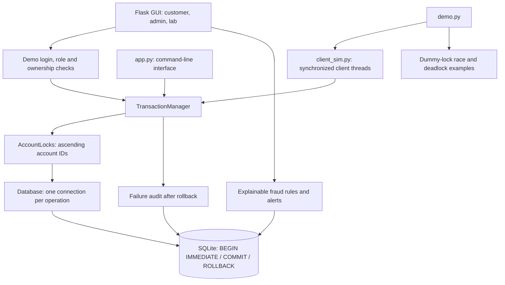
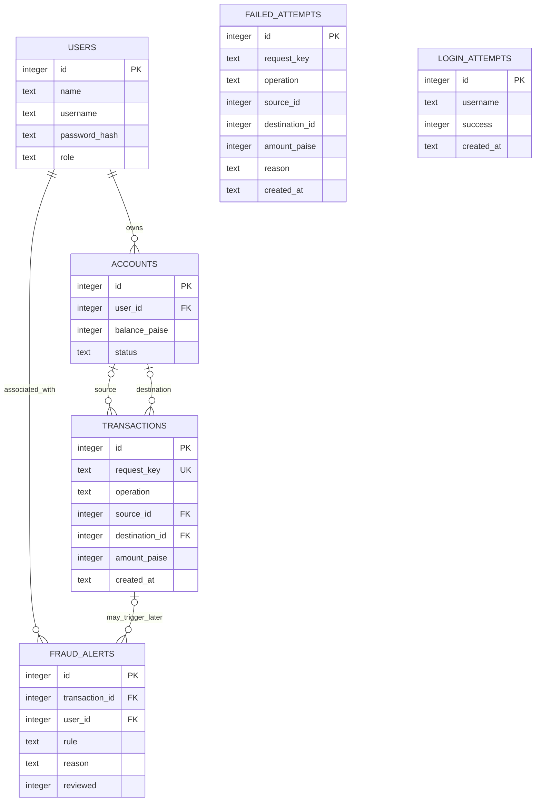

# Architecture and database design

## Components

## Entity relationships

Failure records deliberately do not require foreign keys to accounts: an attempt may refer to a nonexistent account. Login attempts use a username string because an unknown username can also be attempted. Successful transactions are immutable through the application interface; their presence means the full operation committed. Demo users have password hashes and roles; web routes verify ownership before invoking the transaction service.

## Transfer sequence

1. Validate positive integer paise, IDs, request key and distinct accounts.
2. Acquire lower account ID, then higher account ID, with a shared timeout budget.
3. Open a private connection; reserve SQLite's writer with `BEGIN IMMEDIATE`.
4. Check for an existing matching request key. If found, return the committed result without repeating it.
5. Read accounts and check status and funds.
6. Debit source. The optional test hook raises here to demonstrate atomicity.
7. Credit destination and insert the successful transaction record.
8. Commit, close connection, release locks in reverse order.
9. On error: roll back, close, release locks, then attempt a separate failure audit.

## ACID mapping

| Property | Implementation | Evidence / limit |
|---|---|---|
| Atomicity | Debit, credit and history share one transaction | Injected exception after debit leaves both balances unchanged |
| Consistency | Integer amounts, balance checks, constraints and foreign keys | Overspending, invalid values and missing accounts are tested |
| Isolation | SQLite writer reservation before reads plus Python account mutexes | Concurrent deposits and opposing transfers retain correct balances |
| Durability | SQLite commits with synchronous FULL, stored on disk | Reopening sees committed balances; hardware power-loss behavior is not tested |

## PostgreSQL follow-up

For the final version, replace SQLite SQL/connection handling and `BEGIN IMMEDIATE` with PostgreSQL transactions and row locks. Acquire rows one by one in sorted account-ID order with `SELECT ... FOR UPDATE`. Keep database locks as the authoritative protection across processes, use bounded lock waits and roll back deadlock victims. Retest all invariants on PostgreSQL; this prototype does not claim PostgreSQL row-lock behavior.
